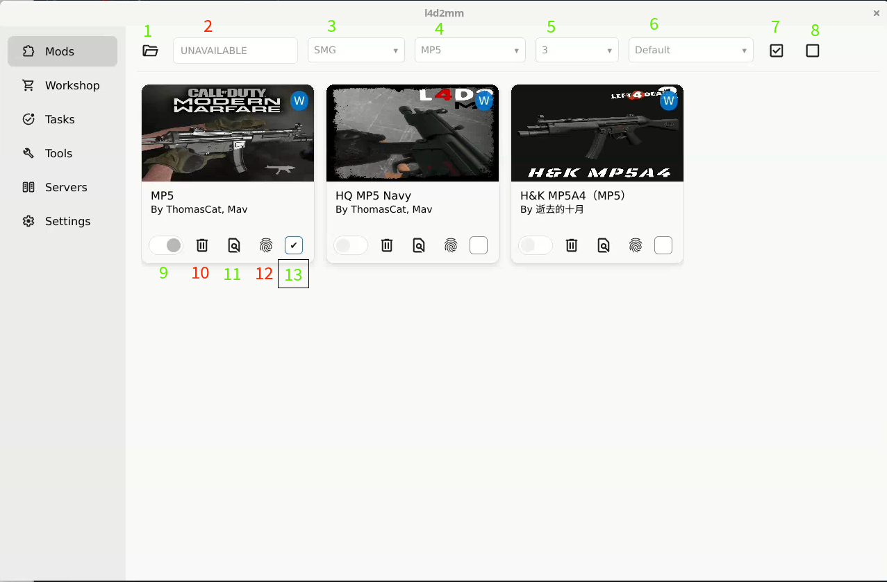
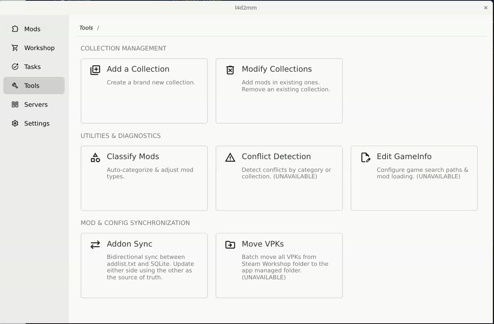

## About l4d2mm
l4d2mm is a modern, native mod manager designed specifically for Left 4 Dead 2 on Linux.

For a long time, the Linux community has lacked a polished, dedicated mod management tool for L4D2. This project aims to bridge that gap, providing Linux gamers with a smooth, native, and reliable way to manage their workshop items, add-ons, and game configurations.

### Screenshots
- W: Workshop vpk (`steam/.../addons/workshop`)
- L: Local vpk (`steam/.../addons`)

<b>Click to expand: Detailed UI breakdown</b>

Green numbers indicate working features, while red numbers indicate features that are not yet available.

1. Select your L4D2 directory. Once a valid path is selected, it will automatically parse both Workshop and local VPKs.
2. Search for specific VPKs (coming soon).
3. Primary categories. These are automatically generated after you run classification in `Tools` (defaults to `All` only).
4. Secondary categories, showing subcategories under a primary one—for example: `Zombies` -> [`Witch`, `Boomer`, ...]. Also auto-generated.
5. Displays the VPK count, which updates dynamically based on the selected category.
6. VPK display/sorting rules.
7. Select all (selects up to 50 VPKs on the current page).
8. Deselect all (deselects up to 50 selected VPKs on the current page).
9. Toggle switch to enable or disable a VPK.
10. Delete VPK (not yet implemented; waiting on Steam API integration—see below for details).
11. View VPK details.
12. Verify VPK integrity to check if a download is complete or if the file is corrupted (implemented under the hood, but disabled until the `Tasks` page is ready).
13. Checkboxes to select multiple VPKs for batch actions, such as creating a new collection or adding them to one or more existing collections.

## 📥 Download & Installation

> ⚠️ **Note for Windows Users:**
> This project is developed on Linux. If you download the Windows release, Windows Defender / SmartScreen may flag or block the executable...（接刚才那段英文）

1. Go to the [Releases](https://github.com/bahyqn/l4d2mm/releases) page.
2. Download the archive for your OS (`linux-amd64`, `windows-amd64`, etc.).

## 🐛 Known Issues & Troubleshooting

### Local VPK images fail to display
* **Cause:** The UI framework's `Image` component currently lacks support for accepting raw image data. This issue has already been reported to the upstream framework author.
* **Workaround:**
  1. In the same directory as the `l4d2mm` executable, create the folder path `assets/imgs/`.
  2. Download [`l4d2.png`](https://github.com/bahyqn/l4d2mm/blob/assets/imgs/l4d2.png) (or grab any image you like online and rename it to `l4d2.png`).
  3. Place it at `assets/imgs/l4d2.png` and restart the app.

## Next Release
- Improve the startup VPK loading logic to display VPKs from `addonlist.txt` by default.
- Implement in-app update functionality.
- Add manual categorization, supporting up to 2 category levels. *(Note: This will break the current database schema, but don't worry—categories will simply be stored separately so you can freely design your own setup.)*
- Add a UI view to display detailed information for map VPKs.
- High-impact features suggested by the community may also be adopted and implemented.

## 🗑️ VPK Deletion & Steam Integration

> ⚠️ **Status: Planned (In Design)**
> 
> **💡 Current Bottleneck:**
> Without Steam API integration, simply deleting a VPK from your local disk doesn't make much sense. Even if you delete the file, Steam will automatically detect that it's missing and redownload it the next time you launch L4D2.
> 
> **🚀 Future Design (Once Steam API is Integrated):**
> Once the Steam API is hooked up, we'll introduce a "soft delete & unsubscribe" workflow to prevent Steam from redownloading removed mods:
> 
> 1. **Soft Delete (`is_removed`):**
>    * Clicking "Delete" in the UI **won't immediately wipe the file from disk**. Instead, it will flag the VPK as `is_removed` in the database and handle the corresponding Steam subscription logic.
> 
> 2. **Dedicated Cleanup View (`Tools`):**
>    * A dedicated section in the `Tools` page will list all mods flagged for removal, letting you **unsubscribe from the Steam Workshop** and permanently delete the files from disk in one place.
> 
> 3. **History & Audit Trail:**
>    * Even after a full deletion, the local SQLite database will **keep the VPK's metadata record**.
>    * A future "Deleted / Unsubscribed History" page will let you review past removals or even restore mods you deleted by mistake.

## 📦 Collection Management

> ⚠️ **Status: Planned (In Design)**
> 
> **💡 Current Design Dilemma:**
> Collection support is currently on hold because auto-classification can still mislabel mods, and many users prefer organizing their VPKs manually. Beyond that, introducing Collections brings up a tricky design problem around maps:
> 
> 1. **Where do `maps` fit in?**
>    * If we use Collections to toggle sets of VPKs on and off, it seems like `maps` should ideally be **excluded from Collections**, leaving Collections strictly for standard VPK mods.
> 
> 2. **The risk of excluding `maps`:**
>    * Custom maps often bundle their own embedded models, textures, and assets. If `maps` are kept outside of Collections, **a map's built-in assets can easily conflict with the standalone VPK models you currently have enabled**.
>    * Worse yet, because those assets are hidden inside the map file, it becomes a nightmare to figure out *which* map is actually causing the conflict.
> 
> > **🎯 Next Steps:**
> > Until we figure out a clean way to handle asset priority between "map-embedded assets" and "standalone VPKs"—or provide reliable conflict tracing—Collections will remain on hold to avoid creating a troubleshooting headache for users.

### ⚠️ VPK Conflict Detection: Current Status & Design Challenges

This feature is currently **on hold**. There are two fundamental logic and architecture issues we haven't found a clean solution for yet:

1. **False positives without classification:**
   * Running conflict detection blindly without classifying VPKs first will lead to a lot of **false positives**.
   * Two VPKs might appear to touch similar underlying paths or filenames while belonging to **completely different categories** (e.g., a UI overhaul vs. a weapon sound pack) and not actually conflicting at all.
   * On top of that, many VPKs lack proper metadata, making it difficult to reliably determine what a file actually contains or overrides.

2. **The "post-classification" paradox:**
   * On the flip side, if we rely on **strict classification** to prevent false positives, conflict detection starts to feel redundant.
   * With a solid category system in place, you can already just **browse by category and cleanly enable or disable the VPKs you want**, naturally avoiding same-category conflicts.

> **💡 Open for Discussion:**
> This feature is still in the exploration phase. If you have ideas on how to balance **simple VPK management** with **accurate conflict detection**, feel free to open an Issue or join the discussion in a PR!