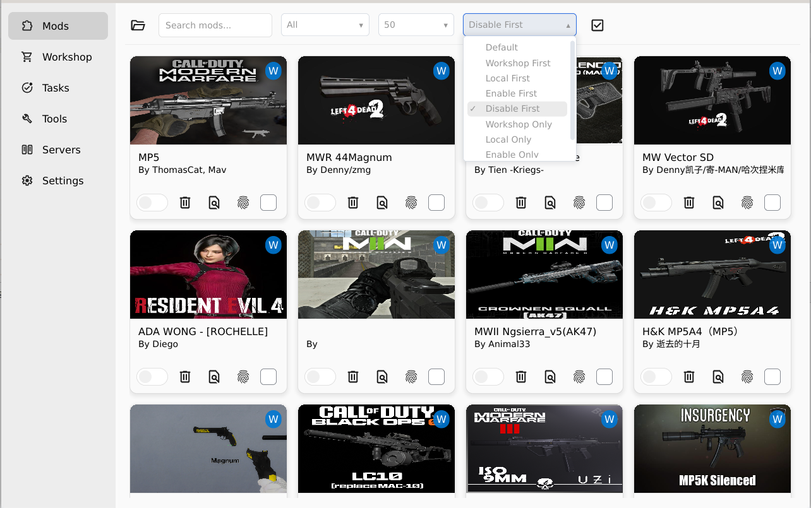
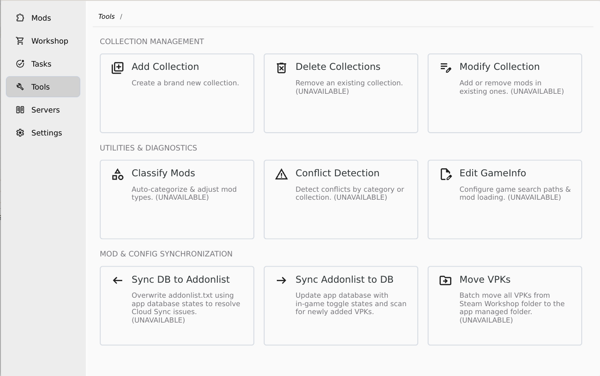

# Application Features & Capabilities

This document provides a comprehensive overview of all application features, organized by page navigation (Sidebar / Aside), along with their current implementation status.

> **Legend:**
>
> - `Completed` - Fully functional and verified
> - `In Progress` - Currently under active development
> - `Planned` - Scheduled for future implementation

## 🧭 Page Breakdown

### 1. Mods

Overview of the vpks

| Feature | Description | Status |
| :--- | : --- | :--- |
| **Choose game cilent folder** | Chooese path where vpks is | `Completed` |
| **Search vpks** | | `Planned` |
| **Categries** | (UNAVAILABLE)I don't have implement it.| `Planned` |
| **Select all vpks (icon)** | Max 50 select (current page) | `Completed` |
| **Cancel all vpks (icon)** | Cancel 50 select (current page)| `Completed` |
| **Tag (icon)** | Show vpk where is from. `W` was from `WORKSHOP`, and `L` was from `LOCAL` | `Completed` |
| **Switch (icon)** | `Enable` or `Disable` vpk | `In progress` |
| **Delete (icon)** | `Delete` vpk from disk,but won't dedlete from `sqlite` | `In progress` |
| **Find (icon)** | Browser vpk information(`addoninfo.txt`, `files`), maps will display `missions`| `In progress` |
| **CRC Verify (icon)**| Checking all the files crc inside vpk | `In progress` |
| **Toggle (icon)** | | `In progress`|

### 2. Workshop

### 3. Tasks

### 4. Tools

1. Add Collection.(`Completed`)
2. Delete Collection.(`In progress`)
3. Modify COllection.(`In progress`)
4. Classify Mods.(`In progress`)
5. Conflict Detection.(`In progress`)
6. Edit GameInfo.(`In progress`)
7. Sync DB to Addonlist.(`In progress`)
8. Sync Addonlist to DB.(`Completed`)
9. Move VPKs.(`In progress`)

### 5. Servers

### 6. Settings
